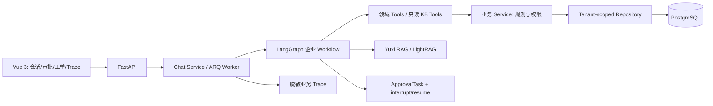

# NexaMind Enterprise

基于开源 [Yuxi](https://github.com/xerrors/Yuxi) 二次开发的企业级 Agent 客服与售后自动化平台。上游提供通用 LangGraph 智能体运行时、知识库/知识图谱、MCP、Skills、沙盒和 Vue/FastAPI 基础；本仓库的企业二开聚焦订单、退款、工单、人工审批、租户权限、评测和业务追踪。代码仍保留 `yuxi` 包名。

> 项目定位：可在本地 Docker Compose 环境演示和测试的企业客服样例。当前不宣称已完成生产部署或取得未经实测的模型效果指标。

## 企业场景

- 企业政策与产品知识问答：复用 Yuxi RAG，返回可核对的检索来源。
- 订单与物流查询：按当前用户的部门租户读取真实业务记录。
- 退款与售后：确定性规则决定自动处理或进入人工审批，支持工单状态流转。
- 运行追踪：查看意图、节点、Tool、审批恢复、Quality Gate 和最终状态。

## 架构图



详细边界见 [企业架构](docs/enterprise/architecture.md) 与 [代码地图](ARCHITECTURE.md)。

## 一次退款请求如何流转

`classify -> extract_entities -> refund_order -> refund -> quality -> finalize`。意图与实体由模型理解，固定 Graph 决定业务节点顺序；`EnterpriseService` 仅接受与订单实付金额相等的整单退款，并校验订单状态、时间和风险。低风险退款自动通过；高风险退款创建 `ApprovalTask`、暂停 Graph，管理员审核后恢复原线程。最终回复必须与订单、退款和审批记录一致。详见 [Workflow](docs/enterprise/workflow.md)。

## Agent Workflow 设计

主流程是基于 LangGraph 的确定性企业 Agent Workflow：意图、实体、订单、退款、工单和质量检查按固定节点及条件边执行，并非多个独立 SubAgent 由 Supervisor 自由调度。只有 Knowledge 节点内部创建只读 Agent，调用 `list_kbs`、`query_kb`；退款操作不能由检索文本触发，业务分支固定经过 Quality Gate。详见 [工作流职责](docs/enterprise/multi-agent-design.md)。

## Human-in-the-loop

审批中心处理高风险退款的 approve/reject。任务保存线程和 Agent 配置，`resume_reviewed_approval()` 在审批提交后恢复 LangGraph checkpoint。审批已入库与恢复成功需分别核验。详见 [人工审批](docs/enterprise/human-in-the-loop.md)。

## 幂等与权限

登录账号 `User` 是企业内部客服/运营人员，不是消费者；`Customer` 是被服务消费者的业务档案，二者没有账号归属关系。`user` 为普通客服，`admin` 为客服主管/租户管理员，`superadmin` 为平台管理员。企业数据使用账号所属部门作为 `tenant_id`；普通客服可在本部门范围查订单、申请退款、创建工单，管理员还可审批及维护业务对象。这里没有“消费者只能查看本人订单”的授权能力，消费者自助门户属于未来工作。API、Service、Tool 共用动作矩阵。退款、工单和审批采用租户内幂等键、唯一约束与 savepoint 处理并发 replay。详见 [权限与租户](docs/enterprise/permission-and-tenant.md) 和 [幂等与错误](docs/enterprise/idempotency-and-errors.md)。

## RAG 与 Grounding

Knowledge Agent 仅能调用 `list_kbs`、`query_kb`。检索内容按不可信数据处理；确定性检查拦截与订单、退款或政策来源矛盾的回答，再进入模型质量检查。详见 [RAG 与 Grounding](docs/enterprise/rag-and-grounding.md)。

## Evaluation

`backend/eval/enterprise/datasets/customer_service_v1.jsonl` 有 50 条案例。Runner 执行真实 Graph，并输出逐例 JSON 与 Markdown。`--limit 5` 仅用于快速冒烟；完整评测使用 `--limit 50`。2026-10-11 在本地 Docker 与演示知识库上使用 `siliconflow-cn:deepseek-ai/DeepSeek-V4-Flash` 完成一次全量运行：**50/50 通过**，禁用 Tool 违规率 0，审批准确率 1，P50/P95 为 7603.78/26151.56 ms。四条产品题均回答了有来源的具体规格。该结果是单次 Demo 数据集实测，不代表生产准确率或长期稳定性；工具执行成功率 0.9178 包含预期的业务拒绝。完整[逐例报告](backend/eval/enterprise/reports/full_verified_2026-10-11/enterprise_eval_20261011T072956Z.md)与口径见[评测说明](docs/enterprise/evaluation.md)。

## Trace / Observability

脱敏业务 Trace 将输入、节点、Tool、审批恢复和最终状态关联到线程与租户；前端在会话面板和 `/enterprise/traces` 查看。已有 Langfuse 负责模型观测，业务 Trace 负责售后对象与决策过程。详见 [观测说明](docs/enterprise/observability.md)。

## Demo

```bash
docker compose up --build -d
docker ps
docker exec api-dev uv run python scripts/seed_enterprise_demo.py
docker exec api-dev uv run --no-sync python scripts/seed_enterprise_policy_kb.py --bind-agent
```

访问 [本地前端](http://localhost:5173)。演示账号种子仅供本地使用，生产环境必须关闭并更换凭证。政策、产品、物流、低额退款、高额批准/拒绝和注入隔离操作见 [Demo 指南](docs/enterprise/demo-guide.md)。演示知识库包含模拟资料并已索引；种子审批任务没有 Agent 线程关联，不能直接演示恢复。

## 测试

```bash
docker exec api-dev uv run --group test pytest
docker exec web-dev pnpm exec eslint . --cache
docker exec web-dev pnpm run build
```

按 `docs/develop-guides/testing-guidelines.md` 区分单元、集成和 E2E。当前全量测试结果、历史失败和仍未消除的安全/部署风险见 [最终实施报告](docs/enterprise/final-implementation-report.md)。

## 本人二次开发内容

企业 Customer/Product/Order/Refund/Ticket/ApprovalTask 领域模型；显式售后 Workflow 与领域 Tool；确定性退款政策和工单状态机；人工审批与原线程恢复；租户权限、并发幂等；企业 Agent 评测数据集与 Runner；脱敏业务 Trace；审批、工单与追踪页面。代码路径与验收证据见 [企业架构](docs/enterprise/architecture.md) 和 [最终实施报告](docs/enterprise/final-implementation-report.md)。[面试问答](docs/enterprise/interview-guide.md) 与 [简历描述](docs/enterprise/resume-description.md) 只陈述可核验能力。

## 与上游 Yuxi 的关系

本项目是 [xerrors/Yuxi](https://github.com/xerrors/Yuxi) 的二次开发，保留上游归属与 [MIT License](LICENSE)。LangGraph 通用平台、RAG、知识图谱、MCP、Skills、Sandbox 及基础前后端来自上游；企业客服与售后模块是本仓库扩展。其他依赖和设计参考包括 [LightRAG](https://github.com/HKUDS/LightRAG)、[DeepAgents](https://github.com/IDEA-CCNL/DeepAgents)、[LangGraph](https://github.com/langchain-ai/langgraph) 和 [RAGFlow](https://github.com/infiniflow/ragflow)。不应把上游社区统计、历史贡献或通用能力误写成二开成果。
