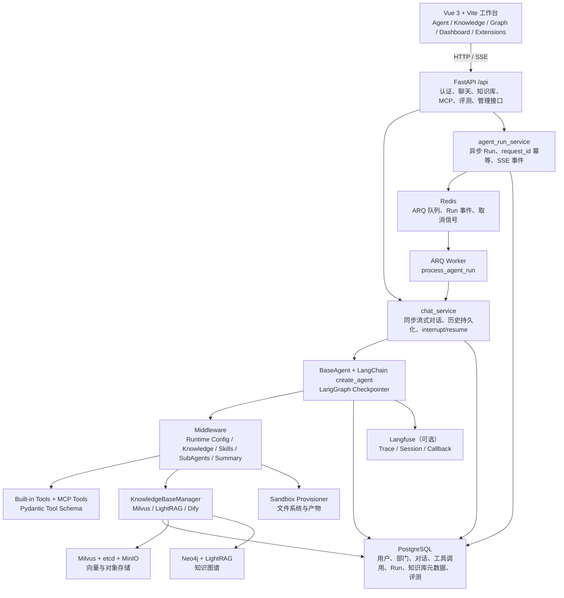
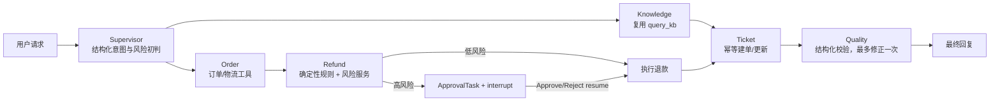

# NexaMind 企业客服 Agent 平台改造审计与计划

> 审计日期：2026-09-30
> 审计范围：当前仓库静态代码、Docker Compose、测试目录与开发文档
> 目标场景：企业智能客服 + 售后工单自动化
> 本文仅完成 Phase 0 架构审计与改造规划，不包含业务代码实现。

> 历史规划文档，不代表当前运行时。现行实现是固定 LangGraph 业务节点，只有 Knowledge 节点内部创建独立只读 Agent；以 [企业架构](./enterprise/architecture.md) 和 [工作流职责](./enterprise/multi-agent-design.md) 为准。

## 1. 审计结论

当前项目已经具备较完整的 Agent 平台底座，不需要重写 Runtime、LangGraph、RAG、MCP、异步任务或前端主框架。最合适的改造方式是在现有 `BaseAgent`、LangGraph checkpointer、Tool/MCP 注册机制、知识库、ARQ Worker 和 Vue 工作台之上，新增一个受控的企业售后领域层。

主要缺口不在“能不能聊天”，而在“是否具备可验证的企业业务闭环”：当前没有客户、商品、订单、退款、工单和审批任务等领域模型；没有确定性的退款规则、风险规则与工单状态机；没有面向业务动作的幂等、租户隔离和权限校验；现有 Evaluation 主要评估知识库检索，不覆盖意图、工具选择、审批准确率和任务完成率。

### 实施进度（2026-10-02）

- 已完成 V1 领域基础：Customer、Product、Order、OrderItem、Refund、Ticket、ApprovalTask。
- 已完成部门级租户隔离、金额 Decimal 化、状态枚举、唯一约束与查询索引。
- 已完成确定性退款规则、审批任务创建、审批联动和工单状态机。
- 已完成 `/api/enterprise/*` 业务 API 与幂等 Demo 数据脚本。
- 已完成结构化意图分类和 Knowledge、Order、Refund、Ticket、Quality 领域节点；仅 Knowledge 节点内部使用只读 Agent，业务节点不经 `SubAgentMiddleware` 委派。
- 已完成企业领域 Tool、运行时 tenant/user/role 注入、高风险退款 `ApprovalTask + interrupt`、管理员审批与原线程 resume。
- 已完成审批中心和售后工单工作台；聊天端遇到企业审批时只展示待管理员处理状态，不允许当前聊天用户自行批准。
- 已使用真实 LLM 完成订单物流查询回归，验证结构化意图路由及订单节点的业务调用；此前“`order-agent` 委派”表述不符合现行运行路径。
- 已将关键业务升级为显式 LangGraph Workflow：固定执行分类、实体提取、领域节点、强制 Quality Gate，质量失败最多修复一次；退款节点复用同一退款工作流服务，避免 Graph 与 Tool 复制规则。
- 已用真实 LLM 完成高额退款 `interrupt → ApprovalTask → 管理员审批 → 原线程 resume → Quality → Final` 回归，并验证订单、退款、审批及 ToolCall 持久化状态一致。
- 已将低额退款幂等、高额审批通过/拒绝与原线程恢复固化为真实自然语言自动化 E2E。
- 已新增独立企业 Agent Evaluation：50 条数据集、隔离业务夹具、真实 Graph Runner、确定性指标、Token/Latency 采集和 JSON/Markdown 报告。
- 代表性 5 条真实模型评测已覆盖低额退款、高额审批、投诉工单、跨租户和 Prompt Injection；评测发现并修复显式角色劫持文本误路由到投诉工单的问题。
- 下一阶段：Enterprise Trace / Observability 与运行信息面板。

建议保持以下原则：

- 复用现有 Agent Runtime，不建立第二套运行时。
- 复用现有 LangGraph `interrupt/resume`，新增持久化审批任务和审批 API。
- 复用现有部门隔离，将 `departments.id` 作为 V1 的租户边界来源。
- 复用现有 RAG、MCP、Tool、ARQ、Redis SSE 和 Langfuse。
- 确定性业务规则放在 Service 层，LLM 仅负责意图识别、编排和自然语言汇总。
- 高风险写操作由固定图节点和权限服务控制，不能由检索文档或自由 Prompt 直接触发。

## 2. 当前真实架构

### 2.1 后端入口与运行链路

- FastAPI 入口：`backend/server/main.py`。
- 路由汇总：`backend/server/routers/__init__.py`，所有接口挂载到 `/api`。
- 生命周期：`backend/server/utils/lifespan.py`，负责数据库、内置 MCP、模型供应商、SubAgent、知识库、Redis、Sandbox 与 LangGraph checkpoint 初始化。
- Agent 抽象：`backend/package/yuxi/agents/base.py`。
- Runtime 上下文：`backend/package/yuxi/agents/context.py`。
- 内置 Agent：`backend/package/yuxi/agents/buildin/chatbot` 与 `deep_agent`。
- 对话编排：`backend/package/yuxi/services/chat_service.py`。
- 异步 Run：`agent_run_service.py` → Redis/ARQ → `run_worker.py` → `stream_agent_chat`。
- Checkpointer：支持 PostgreSQL，失败时回退 SQLite，再失败回退内存。

### 2.2 Agent 与 Multi-Agent

`ChatbotAgent` 和 `DeepAgent` 均继承 `BaseAgent`，通过 LangChain `create_agent` 构建 LangGraph。现有中间件可按运行时配置挂载模型、内置工具、MCP、知识库、Skills、文件系统和 SubAgents。

现有 Multi-Agent 属于“主 Agent 通过 `SubAgentMiddleware` 委派任务”的通用协作能力，已有数据库化 SubAgent 配置和内置 research/critique 子智能体，但没有面向企业售后的确定性 Supervisor 路由、领域状态和专业 Agent 流程。

### 2.3 Tool 与 MCP

- 内置 Tool 使用 `yuxi.agents.toolkits.registry.tool` 注册，同时保留展示元数据。
- Tool 可使用 Pydantic `args_schema`。
- `RuntimeConfigMiddleware` 根据 Agent 配置筛选内置 Tool 和 MCP Tool。
- MCP 使用 `langchain_mcp_adapters.MultiServerMCPClient`，配置存 PostgreSQL，支持 HTTP/stdio、超时、环境变量、请求头和禁用工具过滤。
- 当前 Tool 层缺少统一的企业领域权限、租户校验、业务错误映射和危险操作审计约束。

### 2.4 RAG 与知识图谱

- `KnowledgeBaseManager` 统一管理 Milvus、LightRAG 和 Dify 实现。
- `query_kb`、`list_kbs`、`get_mindmap` 已作为 Agent Tool 暴露。
- Milvus 支持向量检索，并包含 BM25/混合检索相关实现。
- LightRAG 支持图谱构建、Hybrid 查询和可配置 rerank。
- 知识库通过 `share_config` 与部门列表控制访问，Agent 运行时只暴露“用户可访问 ∩ 当前配置启用”的知识库。
- 前端已有知识来源、知识图谱和引用展示组件。
- 当前缺少企业客服专用的 Query Rewrite、统一 grounding 结果模型和 Prompt Injection 对抗测试。

### 2.5 状态、Memory 与 Human-in-the-loop

- Conversation/Message/ToolCall 存 PostgreSQL。
- LangGraph state 通过 PostgreSQL或 SQLite checkpointer 持久化。
- `ask_user_question` Tool 使用真实 `interrupt()`。
- `/api/chat/thread/{thread_id}/resume` 使用 `Command(resume=...)` 恢复图执行。
- 前端已有 `HumanApprovalModal.vue` 和 `useApproval.js`。
- 当前 interrupt 是会话级交互，没有持久化 `ApprovalTask`、审批列表、审批审计、跨用户审批权限和独立审批状态机。
- 当前没有独立 Customer Memory；订单等业务真实状态也尚不存在。

### 2.6 数据与基础设施

- PostgreSQL：业务元数据、用户/部门、对话、工具调用、Agent Run、知识库元数据、RAG 评测。
- Redis：ARQ 队列、Run SSE 事件、取消信号。
- Milvus：向量检索。
- Neo4j：知识图谱。
- MinIO：知识库文件与对象存储。
- Sandbox Provisioner：Agent 文件系统、命令执行和产物。
- Docker Compose：开发环境支持热重载；另有生产 Compose。
- 可选 MinerU/PaddleX 服务用于文档解析与 OCR。

## 3. 能力审计表

| 能力 | 状态 | 真实代码位置 | 复用结论 |
|---|---|---|---|
| Agent Runtime | 已存在 | `agents/base.py`、`services/chat_service.py` | 直接复用 |
| LangGraph | 已存在 | `BaseAgent` checkpointer、`create_agent`、`Command(resume)` | 直接复用 |
| Multi-Agent | 部分存在 | `SubAgentMiddleware`、`subagent_service.py` | 复用委派能力，新增领域 Supervisor 图 |
| Tool Calling | 已存在 | `agents/toolkits`、`RuntimeConfigMiddleware` | 扩展 enterprise tools |
| MCP | 已存在 | `services/mcp_service.py`、`mcp_router.py` | 复用连接和管理能力 |
| RAG | 已存在 | `knowledge/manager.py`、`query_kb` | 直接复用并增加结构化结果 |
| Vector DB | 已存在 | `knowledge/implementations/milvus.py` | 直接复用 |
| Graph RAG | 已存在 | LightRAG、Neo4j adapters | 直接复用 |
| Memory | 部分存在 | LangGraph checkpointer、Conversation/Message | 新增 Customer Memory；业务状态进业务表 |
| Sandbox | 已存在 | `agents/backends/sandbox`、provisioner | 非客服主链路，保留 |
| SSE / WebSocket | SSE 已存在 | chat stream、Run event stream | 复用 SSE；无需新增 WebSocket |
| PostgreSQL | 已存在 | `storage/postgres` | 新增领域表与 repository |
| Redis | 已存在 | `run_queue_service.py` | 复用队列、事件和取消能力 |
| MinIO | 已存在 | `storage/minio` | 复用文件存储 |
| Async Worker | 已存在 | ARQ、`run_worker.py` | 批量 Evaluation 和报告复用 |
| Trace | 部分存在 | Langfuse、ToolCall、AgentRun | 补业务 trace/step/latency 聚合 |
| Evaluation | 部分存在 | RAG benchmark 与 metrics | 新增 Agent 业务评测，不重写现有 RAG 评测 |
| Multi-tenant | 部分存在 | Department、知识库 share_config | V1 映射 Department 为 tenant 边界 |
| Permission | 已完成 V1 映射 | JWT/API Key、`EnterprisePermissionService` | API、Service、Tool 共享领域动作权限矩阵 |

## 4. 需要新增的能力

### 4.1 企业领域模型

新增 Customer、Product、Order、OrderItem、Refund、Ticket、ApprovalTask。所有领域表包含 `tenant_id`，V1 中 `tenant_id` 外键指向 `departments.id`，从当前用户的 `department_id` 注入，避免同时引入一套与现有部门权限平行的租户系统。

状态字段使用 Python Enum + 数据库约束；金额使用 `Numeric/Decimal`，禁止 Float；订单号、SKU、幂等键设置租户内唯一约束；常用筛选字段建立组合索引。

### 4.2 确定性业务服务

- `OrderService`：订单、明细和物流查询。
- `RefundPolicyService`：期限、状态、金额等确定性资格判断。
- `RiskService`：客户风险、投诉和高额退款判断。
- `RefundService`：退款请求、审批后执行和幂等保护。
- `TicketService`：工单创建幂等与状态机。
- `ApprovalService`：审批创建、领取、通过、拒绝和审计。
- `EnterprisePermissionService`：租户边界与危险动作权限。

Agent 和 Tool 只能调用 Service/Repository，不能直接拼 SQL。

### 4.3 企业流程早期方案草图（非现行执行图）

新增一个内置 `EnterpriseServiceAgent(BaseAgent)`，使用同一 Runtime 和 checkpointer。建议使用显式 LangGraph StateGraph/子图组织以下节点：

以下是当时的设计草图，其中 Supervisor 和跨分支连接不代表当前执行边；现行节点和条件边见 `backend/package/yuxi/agents/buildin/enterprise_service/graph.py`。

Supervisor 使用 structured output/Pydantic Schema；流程跳转由图条件边决定，不能只靠关键词。退款、审批、工单写操作由固定节点调用 Service，避免自由 Agent 根据知识库文本直接执行危险动作。

### 4.4 业务审批中心

复用现有 `interrupt/resume`，但新增 `ApprovalTask` 持久化和 `/api/approvals` API。审批页面不直接拥有任意线程的恢复权限；审批 Service 在校验 tenant、reviewer、状态和幂等键后更新任务，再由受控服务恢复对应 LangGraph thread。

### 4.5 Agent Evaluation

保留现有知识库 Evaluation，另增企业业务数据集和 runner，覆盖：

- Intent Accuracy
- Tool Selection Accuracy
- Tool Execution Success Rate
- Task Completion Rate
- Approval Accuracy
- Retrieval Recall@K
- Answer Faithfulness
- Latency
- Token Cost

当前已实现除 LLM Judge 与价格估算之外的确定性指标。未配置可信 Judge 或模型价格时，
Faithfulness、Answer Completeness 和 Estimated Cost 明确输出 `N/A`，不生成推测值。

## 5. 原需求需要按现有代码调整的设计

1. **不新增第二套 Agent Runtime**：企业客服作为新的内置 Agent/Graph 接入 `BaseAgent` 和现有 chat/run 链路。
2. **Supervisor 不直接等同于现有 SubAgentMiddleware**：现有委派适合开放任务，退款等危险流程需要显式状态图和条件边。
3. **租户先复用 Department**：V1 的 `tenant_id` 关联 `departments.id`；若未来一个租户内需要多个部门，再单独引入 Tenant/Organization，不在本轮同时重构认证体系。
4. **审批复用 interrupt，但不能只复用聊天弹窗**：必须新增 ApprovalTask、审批查询 API、审计字段和受控恢复服务。
5. **Evaluation 增量扩展**：当前是知识库检索/回答评测，企业 Agent 评测应独立目录和 runner，共用已有指标与异步任务基础设施。
6. **异步体系复用两层现状**：Agent 长任务使用 ARQ/Redis Run；当前 RAG Evaluation 使用内存 Tasker，V3 应逐步迁移批量评测到现有 Worker，避免 HTTP 进程承担长任务。
7. **迁移方式遵循仓库现实**：当前主要依赖 SQLAlchemy `create_all` + `ensure_business_schema`，没有完整 Alembic 流程。新增表可由 ORM 建表；后续字段变更必须补显式、幂等 schema migration，并为生产迁移保留回滚说明。
8. **权限角色不立刻重写**：先映射 `superadmin/admin/user` 到企业动作权限；客户实体和登录用户分离。V2 再评估 support/manager 等角色扩展。
9. **前端只增量加页面**：沿用 `AppLayout`、现有 API 封装、聊天流和审批组件，新增 Enterprise、Approvals、Tickets、Trace 页面。
10. **Prompt Injection 通过架构隔离**：检索内容只能作为不可信上下文；写操作条件由 Service 结果、权限和图状态决定，不能由知识库指令触发。

## 6. 分阶段改造计划

### V1：企业业务闭环

目标：完成可运行的“知识问答 → 订单查询 → 退款判断 → 自动退款/人工审批 → 工单 → 质量校验”Demo。

1. 新增企业领域 ORM、Repository、Service 和 schema migration。
2. 新增幂等 Demo 数据脚本：5 客户、10 产品、20 订单及退款/工单场景。
3. 新增 `/api/customers`、`/api/orders`、`/api/refunds`、`/api/tickets`、`/api/approvals`。
4. 新增 enterprise domain tools，全部通过 Service 调用。
5. 新增 `EnterpriseServiceAgent`、结构化意图 Schema 和领域 State。
6. 接入现有 RAG 作为 Knowledge 节点。
7. 接入 ApprovalTask + LangGraph interrupt/resume。
8. 新增最小 Approvals/Tickets 页面和聊天右侧业务运行信息。
9. 单元、集成和一条关键 E2E 覆盖自动退款与人工审批。

验收：文档中的 A-D Demo 可运行，重复请求不会产生重复退款或重复工单。

### V2：企业级安全与稳定性

目标：让写操作具备明确的租户、权限、幂等、错误和重试边界。

1. 完善 tenant scope 注入与所有 Repository 查询隔离。（已完成）
2. 建立领域权限矩阵和 Tool 级授权。（已完成）
3. 为退款、工单、审批增加幂等键和数据库唯一约束，并在并发冲突时通过 savepoint replay 同一业务对象。（已完成）
4. 建立 BusinessError、RetryableError、PermissionError、ValidationError、ExternalServiceError。（已完成）
5. 只对 RetryableError 做最多两次指数退避。（已完成）
6. 增加 Prompt Injection、越权、跨租户、重复退款测试。
7. 对日志、Tool 输入输出和 Trace 中的 token/api_key/password/phone/email 脱敏。
8. 收紧 API 错误信息，隐藏数据库和外部服务内部异常。

验收：文档中的 E-F Demo 通过，跨租户访问、越权审批和重复写操作均被阻断。

### V3：Evaluation 与可观测性

目标：让 Agent 行为可量化、可回放、可解释。

1. 在 Langfuse 元数据中补 tenant、intent、risk、approval、business_id。
2. 复用 AgentRun/ToolCall，补 AgentStep 或结构化 step event。
3. 采集模型 token、节点 latency、tool latency/error、retrieval latency/docs。
4. 已新增 50 条企业客服评测数据和 `python -m yuxi.evaluation.enterprise.runner`。
5. 已输出 `latest.json` 和 `latest.md`；Worker 批量执行待后续接入。
6. 新增 Trace 页面和关键指标 Dashboard。
7. 完成架构、Agent、RAG、MCP、HITL、安全、评测、面试与简历文档。

验收：可展示一条售后请求的完整节点、Tool、审批、耗时、引用和最终状态，并生成离线评测报告。

## 7. V1 预计修改与新增文件

以下是预计范围，Phase 1 开始前仍应以最小实现再次确认。

### 后端领域层

- 修改：`backend/package/yuxi/storage/postgres/models_business.py`
- 修改：`backend/package/yuxi/storage/postgres/manager.py`
- 新增：`backend/package/yuxi/repositories/enterprise_repository.py`，或按领域拆分 repository
- 新增：`backend/package/yuxi/services/order_service.py`
- 新增：`backend/package/yuxi/services/refund_service.py`
- 新增：`backend/package/yuxi/services/ticket_service.py`
- 新增：`backend/package/yuxi/services/approval_service.py`
- 新增：`backend/package/yuxi/services/enterprise_permission_service.py`
- 新增：`backend/scripts/seed_enterprise_demo.py`

### API 与 Agent

- 新增：`backend/server/routers/enterprise_router.py`
- 修改：`backend/server/routers/__init__.py`
- 新增：`backend/package/yuxi/agents/toolkits/enterprise/`
- 新增：`backend/package/yuxi/agents/buildin/enterprise_service/`
- 可能修改：`backend/package/yuxi/services/chat_service.py`，仅补企业审批恢复与运行元数据

### 前端

- 新增：`web/src/apis/enterprise_api.js`
- 修改：`web/src/apis/index.js`
- 新增：`web/src/views/ApprovalView.vue`
- 新增：`web/src/views/TicketView.vue`
- 新增：`web/src/components/EnterpriseRunPanel.vue`
- 修改：`web/src/router/index.js`
- 修改：`web/src/layouts/AppLayout.vue`
- 复用/扩展：`HumanApprovalModal.vue`、`useApproval.js`

### 测试

- 新增：`backend/test/unit/services/test_refund_policy_service.py`
- 新增：`backend/test/unit/services/test_ticket_service.py`
- 新增：`backend/test/unit/services/test_enterprise_permission_service.py`
- 新增：`backend/test/unit/agents/test_enterprise_intent.py`
- 新增：`backend/test/integration/api/test_enterprise_router.py`
- 新增：`backend/test/integration/api/test_approval_workflow.py`
- 新增：`backend/test/integration/api/test_enterprise_tenant_isolation.py`
- 新增：`backend/test/e2e/test_enterprise_refund_workflow_e2e.py`

### 文档与配置

- 修改：`docker-compose.yml` 与必要环境变量示例
- 修改：`README.md`
- 修改：`docs/develop-guides/roadmap.md`
- 后续新增 Agent/RAG/MCP/HITL/Evaluation/Security/Interview 文档

## 8. V1 数据设计要点

| 实体 | 关键约束 |
|---|---|
| Customer | `(tenant_id, email)`、`(tenant_id, phone)` 可选唯一；风险等级索引 |
| Product | `(tenant_id, sku)` 唯一；status/category 索引 |
| Order | `(tenant_id, order_no)` 唯一；customer/status/created_at 组合索引 |
| OrderItem | order/product 外键；quantity > 0；金额 Decimal |
| Refund | tenant/order/customer 外键；`idempotency_key` 唯一；status/risk 索引 |
| Ticket | tenant/customer/order 外键；`idempotency_key` 唯一；状态机校验 |
| ApprovalTask | `(tenant_id, business_type, business_id, idempotency_key)` 唯一；reviewer/status 索引 |

不建议把状态只存在 JSON 或 Agent state 中。LangGraph state 保存编排上下文和业务 ID，最终业务状态以 PostgreSQL 领域表为准。

## 9. 测试与验收策略

### Unit

- 退款金额边界：`100.00` 自动，`100.01` 审批。
- 已退款、订单不存在、超期、高风险和投诉场景。
- 工单合法/非法状态迁移。
- 幂等键重复调用。
- structured intent schema 与低置信度回退。
- tenant/role 权限矩阵。

### Integration

- Agent Tool → Service → PostgreSQL。
- 创建 ApprovalTask → interrupt → approve/reject → resume。
- 跨租户订单、工单、审批均返回 404/403。
- RAG 引用可追踪且不能触发写 Tool。

### E2E

- 59 元破损退款自动执行，不产生待审批任务。
- 899 元退款进入审批，批准或拒绝后恢复原线程并完成 Quality Gate。
- 同一线程重复自然语言请求不会重复退款、审批任务或工单。
- 恶意知识库文本不能触发退款 Tool。

## 10. 当前风险与前置事项

- Docker Desktop 已恢复，开发容器与 PostgreSQL、Redis、Milvus、Neo4j、MinIO 已通过健康检查。
- 工作区已有未提交的品牌、提示词、前端和默认账号种子改动，本计划未修改或覆盖这些文件。
- `README.md` 仍包含旧品牌和上游公开链接，与当前 NexaMind UI 不一致，后续文档阶段应统一，但不应混入 Phase 1 领域开发。
- Compose 当前默认启用演示账号且包含默认密码，适合本地 Demo，不适合生产；V2 必须默认关闭或要求显式配置。
- 当前 CORS 为 `allow_origins=["*"]` 且允许凭证，生产部署前必须按环境收紧。
- 当前数据库演进没有完整 Alembic 版本链，领域表上线前应补可追踪的迁移策略。

## 11. Phase 1 开始条件

建议开始 Phase 1，但仅在以下条件满足后进入实现：

1. 确认 V1 使用 `departments.id` 作为 `tenant_id` 的来源。
2. 启动 Docker，确认 `api-dev`、`web-dev`、`worker-dev`、PostgreSQL 和 Redis 健康。
3. 对现有未提交改动做一次基线备份或提交，避免企业领域改造与品牌改动混杂。
4. 先实现领域模型、Repository、Service 和 Demo 数据，再接 Agent；不从 Prompt 或前端倒推数据库逻辑。
