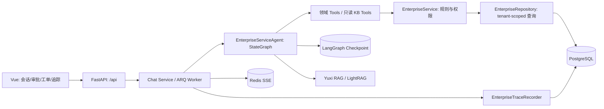

# 企业客服架构

NexaMind Enterprise 是基于上游 Yuxi 的企业客服与售后场景二次开发。Yuxi 提供通用 LangGraph 运行时、知识库、图谱、MCP、Skills、沙盒、会话和前后端基础；本仓库增加企业领域模型、确定性业务服务、显式售后 Workflow、审批、评测与业务 Trace。

企业运行路径是 `EnterpriseServiceAgent` 编译的固定 `StateGraph`。订单、退款、工单和质量检查是业务节点，不是独立 SubAgent；仅 Knowledge 节点内部调用只读 Agent。通用 SubAgent 配置不参与该企业 Workflow 的路由。

## 身份与数据边界

认证主体 `User` 是企业内部客服/运营人员账号，角色 `user`、`admin`、`superadmin` 分别表示普通客服、客服主管/租户管理员、平台管理员。`Customer` 是被服务消费者的业务实体，不是登录账号；当前没有 `User -> Customer` 归属关系。企业 API 从登录账号所属部门取得 `tenant_id`，按部门隔离业务数据，而不是按消费者本人隔离订单。即使是 `superadmin`，企业业务接口仍按当前部门限定数据范围。消费者登录与本人订单查询需要另建账号绑定和所有权校验，属于未来工作。

## 边界

| 层 | 负责 | 代码 |
| --- | --- | --- |
| 前端 | 输入、审批、运行信息展示 | `web/src/views/ApprovalView.vue`、`TicketView.vue`、`EnterpriseTraceView.vue` |
| API | 认证、tenant/role 上下文、HTTP 错误映射 | `backend/server/routers/enterprise_router.py` |
| Graph | 意图分类、实体提取、固定路由、Quality Gate | `backend/package/yuxi/agents/buildin/enterprise_service/graph.py`、`nodes.py` |
| Tool | Agent 可调用的领域能力 | `backend/package/yuxi/agents/toolkits/enterprise/` |
| Service | 退款政策、工单状态机、权限、审批 | `backend/package/yuxi/services/enterprise_service.py` |
| Repository | 含 tenant_id 的查询与幂等写入 | `backend/package/yuxi/repositories/enterprise_repository.py` |
| 观测 | 脱敏业务事件与统计 | `backend/package/yuxi/services/enterprise_trace_service.py` |

数据库事实优先于模型回答。模型不能决定退款阈值、审批权限或订单状态；这些由 Service 和数据库约束控制。开发拓扑以 `docker-compose.yml` 和根目录 `ARCHITECTURE.md` 为准。
