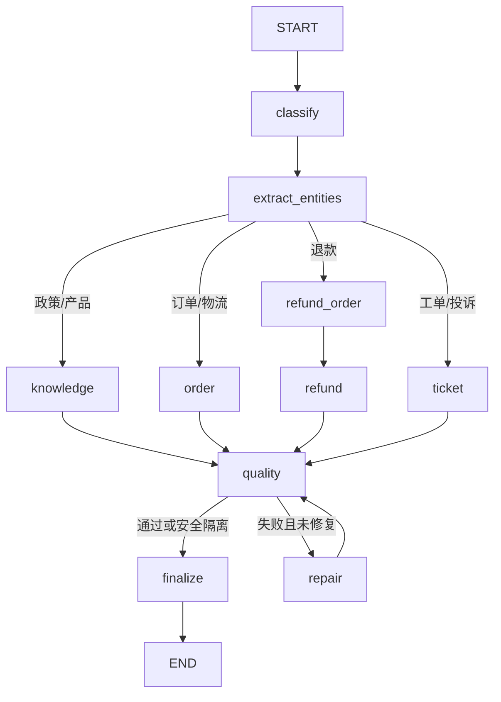

# 售后 Workflow

`build_enterprise_workflow()` 定义固定 `StateGraph`：`classify -> extract_entities -> route`，分别进入 knowledge、order、refund_order -> refund 或 ticket；业务分支都进入 `quality`，失败最多执行一次 `repair`，然后 `finalize`。未知意图直接给出澄清答复。

分类器将业务对象 `domain`、业务动作 `action`、工单类型 `ticket_type`、风险等级与安全信号分开输出；条件边优先按 `domain + action` 路由。`intent` 作为旧 Trace、Eval 与前端的兼容字段保留，旧 checkpoint 缺少新字段时仍可按 `intent` 路由；普通售后工单创建仍映射为旧 `ticket_query`，不能再用旧字段判断读写动作。`order+logistics` 与 `order+query` 均进入订单节点；`ticket+create` 创建售后工单，投诉类型使用高优先级；`ticket+query/status` 只读查询。有明确订单标识的恶意退款请求保留退款业务域，并标记 `instruction_override`；退款节点在写入前安全拒绝，不把安全信号当作未知业务意图。

实体来自另一结构化模型输出。退款必须先验证订单并解析金额、原因；`execute_enterprise_refund` 调用确定性 Service，仅允许退款金额等于订单实付金额，低风险自动通过，高风险创建 `ApprovalTask` 并暂停运行。审批恢复后再检查真实业务状态。

`deterministic_grounding_issues` 先检查订单、退款和政策来源的事实矛盾，然后才调用模型质量检查。未通过 Quality Gate 的结果不会被包装成成功答复。参见 `backend/package/yuxi/agents/buildin/enterprise_service/nodes.py`、`refund_workflow.py` 和 `backend/test/unit/agents/test_enterprise_workflow.py`。
